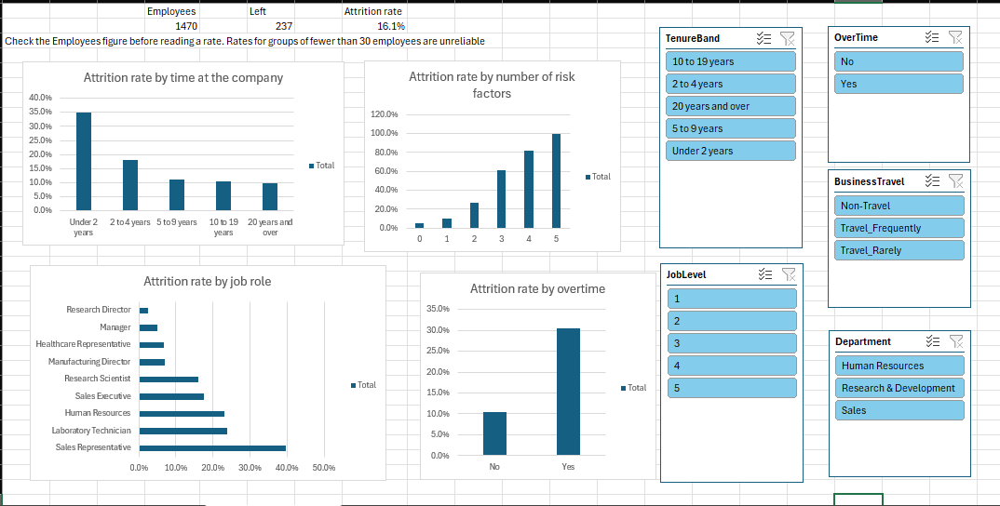

# HR Employee Attrition Analysis (Excel)

An Excel analysis of employee attrition in the IBM HR Analytics dataset (1,470 fictional employees). The project cleans the data in Power Query, documents every decision, answers ten business questions with PivotTables, and ends with a dashboard that a manager can explore with slicers.

This is project 4 of my data analytics portfolio. The earlier projects use SQL (retail sales and Czech bank loans) and Python (bank marketing). This one is built entirely in Excel, to show Power Query, XLOOKUP, PivotTables, PivotCharts and slicers.

## The question

Which employees leave, and what do they have in common? An HR manager who knows where leaving is concentrated can look at the right jobs, groups and working conditions first.

| Measure | Value |
| --- | --- |
| Employees | 1,470 |
| Employees who left | 237 |
| Attrition rate | 16.1% |

## The data

- **Source:** the IBM HR Analytics Employee Attrition and Performance dataset on Kaggle (file WA_Fn-UseC_-HR-Employee-Attrition.csv). It has 1,470 rows, one per employee, and 35 columns.
- **The data is fictional.** IBM data scientists created it, so every finding describes patterns in this dataset and not in a real organisation.
- **There is no date column,** so the project cannot show whether attrition changed over time. Time at the company is used instead.
- **The raw file is not in this repository.** Data files are excluded with a .gitignore. The workbook contains the cleaned table.

## How the workbook is built

The workbook uses a chain of Power Query queries, so the raw data is never edited.

| Layer | What it does |
| --- | --- |
| raw_hr_attrition | Loads the file unchanged, with every column as text. Connection only. |
| typed_hr_attrition | Sets data types in a separate query that references the raw one. |
| clean_hr_attrition | Removes three columns that hold the same value in every row, adds the attrition flag, the bands and the risk factor columns, and loads the result into a worksheet. |

The clean table has 48 columns and 1,470 rows. XLOOKUP formulas and lookup tables turn coded columns such as Education and JobSatisfaction into readable labels. A calculated attrition flag (1 for left, 0 for stayed) lets a PivotTable show the attrition rate as an average.

Quality checks:

- **Validation sheet:** 27 checks compare the clean table against the raw data (employee counts, sums of age and monthly income) and test every label and band. Every check matches.
- **Reconciliation:** every PivotTable was reconciled to the baseline totals above before any result was used.
- **Decision log:** 22 decisions, each with what was found, what was decided, why, and the limit of the decision.

## Business questions and main results

Each question has a full write-up with tables, interpretation and limitations in docs/findings.md.

| No. | Business question | Main result |
| --- | --- | --- |
| 1 | How do attrition rates differ by department and job role? | Sales had the highest department rate (20.6%), but the Sales Representative role left at 39.8% (83 employees) while Sales Executives left at 17.5%. |
| 2 | Do employees who work overtime leave more often? | Yes: 30.5% with overtime against 10.4% without, and the gap holds in every department and nearly every role. |
| 3 | Is lower pay linked to higher attrition? | Mostly a job level 1 pattern. Level 1 left at 26.3%, and inside level 1 the lowest pay band left at 29.4% against 19.1% for the next band. |
| 4 | How does attrition change with time at the company? | It falls steeply: 34.9% under 2 years, 18.1% at 2 to 4 years, then about 10% from 5 years. Level 1 employees with under 2 years left at 44.1% (136 employees). |
| 5 | How do age and marital status relate to attrition? | Employees under 35 left at 23.0% against 10.6% for those 35 and over. Single employees left at 25.5%, mostly among the younger ages. |
| 6 | Does a long gap since the last promotion go with higher attrition? | No steady link. Among employees with 5 or more years at the company, a gap of 6 to 10 years went with 18.1% against 9.3% for other gaps. |
| 7 | Do business travel and distance from home matter? | Frequent travellers left at 24.9% against 8.0% for non-travellers, and this holds within overtime and department. Distance is a weaker pattern. |
| 8 | Which rating scale shows the biggest gap between low and high ratings? | Job involvement: the lowest rating had an attrition rate of 33.7% (28 of 83 employees), against 13.6% (138 of 1,012 employees) for the High and Very High ratings combined, a gap of 20.1 percentage points. Tables 8.1 and 8.2 in docs/findings.md. |
| 9 | Do performance rating, salary increase and training matter? | No clear pattern. Employees with no training at all left at 27.8% (54 employees), a weak signal on a small group. |
| 10 | Which combination of factors has the highest attrition? | Employees with 3 or more of five risk factors left at 65.0% (100 employees). Among groups of at least 30 employees, job level 1 with overtime was highest at 38.8%. |

What this means for an HR manager: leaving is concentrated in specific roles, in the first two years at the company, among employees at job level 1, and among those who work overtime or travel frequently. These factors add up, and a small group with several of them accounts for a large share of leavers. A department figure alone would point attention to the wrong place.

## The dashboard

The attrition_dashboard sheet shows four PivotCharts (time at the company, number of risk factors, job role and overtime) and three headline figures (employees, leavers and attrition rate). Five slicers (Department, JobLevel, OverTime, BusinessTravel and TenureBand) filter every chart and figure together. The headline figures were checked against the earlier tables for several slicer settings.

## What I learned

- **Test every finding within subgroups.** The department rates hid large differences between roles, and overtime, pay and age patterns each changed once job level or time at the company was held the same.
- **Check documented meanings against the data.** The performance rating has only two of its four documented values, and salary increase and performance rating always move together, so the data cannot separate them.
- **Reconcile after every step.** A pivot built on the wrong field and a label column pointing at the wrong code both showed no errors. Only comparing against known totals found them.
- **Say what the data cannot show.** Every question lists its limitations, and the ten questions state where groups are too small to read.

## Repository structure

    hr-attrition-analysis/
    ├── data/
    │   └── README.md
    ├── docs/
    │   ├── decision-log.md
    │   └── findings.md
    ├── images/
    │   └── dashboard.png
    ├── workbook/
    │   └── hr_attrition_analysis.xlsx
    ├── .gitignore
    └── README.md

## Skills shown

- **Power Query:** layered queries, data types, conditional and custom columns.
- **XLOOKUP:** lookup tables that turn codes into labels, with reverse lookups to check them.
- **PivotTables:** counts, sums and averages by group, nested groups, and subgroup checks.
- **Formulas:** validation checks with COUNTIF, SUMIFS, SUMPRODUCT and GETPIVOTDATA.
- **PivotCharts and slicers:** a dashboard where every chart responds to the same filters.
- **Documentation:** a decision log and plain-English findings with every figure traceable to a table.

## Limitations

- The data is fictional, so the patterns may not match any real organisation.
- The results are associations. The data does not show why employees left.
- The data has no dates, so it cannot show change over time.
- The five risk factors in question 10 were chosen from patterns found in the same data, so the steep rise in the rate overstates how well the count would work for other employees.
- To rebuild the workbook, download the Kaggle file and point the raw_hr_attrition query at it, since the query holds the file path from my computer.

## About me

- Michael Onojah, Electrical and Electronics Engineering graduate (Federal University of Technology Akure, 2025), moving into entry-level data analytics.
- Skills: SQL, Excel, Power BI and Python.

- GitHub: [HonourJAH](https://github.com/HonourJAH)
- LinkedIn: linkedin.com/in/friday-onojah-9a5698219
